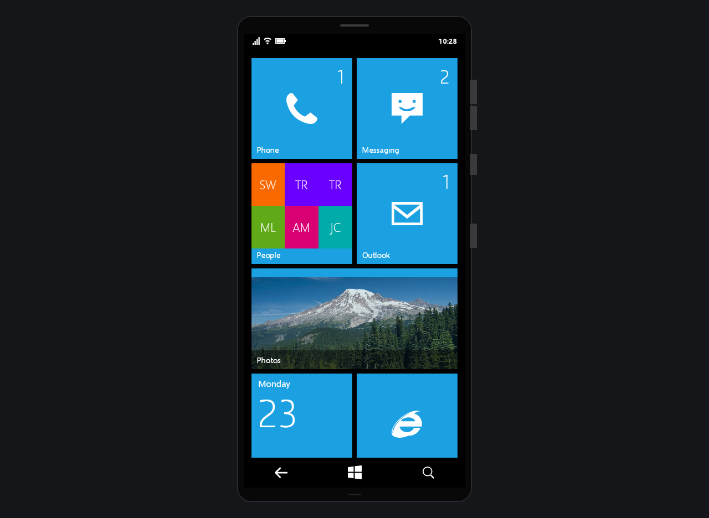

# Windows Phone

A Windows Phone 8.1 Update experience built with **FerroUI, Rust and declarative `rsx!` views**. The Start screen, apps, controls, navigation and data model run in FerroUI; portable host adapters supply storage, files, power observations and platform integrations.

[Open the app](https://ferroui.com/WindowsPhone/) · [App SDK](docs/sdk.md) · [Original references](docs/reference.md) · [Architecture](docs/architecture.md) · [Host integration](docs/host-integration.md) · [Feature and fidelity status](docs/parity.md)

The reference release is **Windows Phone 8.1 Update (2014)**, including live folders and the original `system` / `applications` Settings pivots. This is a working app recreation, not an operating system or an emulator for XAP/APPX applications. **Complete visual and feature parity has not been established.** The [parity document](docs/parity.md) records the implemented workflows and the remaining differences.

## Preview

The browser renders the retained FerroUI control tree through WebAssembly. These captures come from the passing full browser verification of runtime `73dc39f`, using isolated sample data and native pointer, keyboard and touch input. The subsequent `9c392ef` refinement corrects singular Minesweeper counter labels; the retained images keep their original capture attribution.



[Mobile Start](docs/screenshots/sdk-start-mobile.png) · [Tic tac toe](docs/screenshots/sdk-tic-tac-toe.png) · [Minesweeper](docs/screenshots/sdk-minesweeper-playing.png) · [Restored minefield](docs/screenshots/sdk-minesweeper-restored.png) · [Store app management](docs/screenshots/sdk-store-disabled.png)

[Capture provenance](docs/screenshots/README.md) records the exact build, artifact and unmodified image sources. It also retains the earlier Calendar, Office, Files, host-integration and published-app captures. These are application captures, not original Windows Phone screenshots or a certification of pixel parity.

## Explore

- **Start:** live content and notification counts, small/medium/wide tiles, pin/unpin, resize, reorder, folders that preserve their child tiles, secondary content tiles, accent colors, light/dark backgrounds, a shared scrolling photo behind transparent tile interiors, press-location tilt feedback, and the optional extra tile columns. Decorative motion respects reduced motion and Battery Saver.
- **Phone navigation:** swipe between Start and the alphabetical Apps list; search, measured letter jumps and sticky group headings; Back/Start/Search buttons; recent-app cards; configurable lock wallpaper and status providers; grouped Action Center notifications and deep links.
- **System controls:** separate ringer/notification and media/app volume, mute and vibration controls; a hardware-style volume panel; light/dark and high-contrast themes; reduced motion; live-tile preferences; date order and calendar week start. Battery information uses an actual host reading when available; storage views measure the saved phone document and separately show browser-origin storage estimates and persistence permission.
- **Messaging and Outlook:** search local threads and mail, select rows from the left edge or a held item, and apply bulk actions. Messaging includes contact selection, unknown-number contact creation, drafts, and copy/forward/delete commands on individual messages. Outlook includes folders, all/unread/flagged views, bulk read/flag changes, deleted items and restore. Compose actions explicitly open the host's messaging or email app; local drafts do not claim delivery.
- **Calendar:** day, week, month and year navigation; inline month appointments and an hourly day view with separate columns for overlapping appointments; native date/time controls; all-day appointments, duration, reminders, status and notes; daily/weekday/weekly/biweekly/monthly/yearly repeats with an end date and individual-occurrence editing or deletion. Start and lock details use the same occurrence engine. Import/export supported local-time iCalendar files and share a saved appointment or series.
- **Alarms and reminders:** native time/name/repeat/snooze editing, one-time and weekday alarms, foreground alert screens, configurable snooze and dismissal, and the original two-minute alarm snooze on Back. A Calendar reminder opens its occurrence. The browser plays a synthetic tone using the saved ringer level when browser audio is available; permitted foreground alert banners can also appear through device notifications. Delivery requires the app to remain running.
- **Personal apps:** contacts and favorites, atomic vCard imports, contact-file copy/sharing, call history, notes, and a calculator. OneNote imports bounded UTF-8 TXT/Markdown files through the shared SDK file chooser.
- **Office and Files:** a persistent document library with folders, search, sorting, multi-selection, atomic file copy/move, rename, properties, file sharing and secondary Start tiles. New creates Word or Excel documents; existing supported PowerPoint presentations offer text and speaker-note editing. Excel includes typed range selection, five AutoSum operations, workbook find, range clear and bounded single-key value sorting. Native editors share real DOCX/XLSX/PPTX import/export; UTF-8 TXT and CSV imports are supported too. Complex unsupported Office structures are rejected, and imported supported OOXML files export or share as explicitly named mobile copies.
- **Media:** import photos, browse the Camera Roll, select favorites, zoom, share, and delete; capture from the camera; import audio and video and play them through browser media APIs with OS Media Session controls. The desktop host supplies embedded FerroUI media/camera providers, native texture surfaces, and a separate foreground alarm player. Availability depends on platform permissions, renderer and installed codecs; external-player handoff remains an explicit command.
- **Web and services:** native browser tabs with independent Back/Forward journals, frequent sites and history, editable/pinnable favorites, and a configurable address-bar shortcut. Web search, OpenStreetMap handoff, current weather after location permission, local Cortana-style search and commands, and online-document links use explicit host integrations.
- **Games and Store:** independent Tic tac toe and Minesweeper SDK apps with validated resumable games and persisted results. Tic tac toe offers a perfect phone opponent, two-player mode and unfinished-turn undo. Minesweeper offers three difficulties, safe opening areas, flags, chord reveal and best times. Games discovers registered game apps; Store enables, disables, pins and resets linked SDK apps. The original cloud Store and Xbox services are not connected.
- **App SDK:** immutable manifest registration, independent app routes, lifecycle/input hooks, typed app-owned session state, bounded JSON storage, data activation, custom live tiles and a cancellable typed host file picker. All built-in apps and the three Office editors live in separate crates. A scaffolder and compiled example show how to add another app without editing the system shell.
- **Persistence:** phone data stays in its host profile; browser media uses IndexedDB and desktop media uses app-owned files. Export and restore compatible JSON/media backups, including both wallpapers. Restore validates and saves before replacing live state; native restore preserves a recovery snapshot. The app includes a manifest and service worker for installation and offline shell use.

The first run contains fictional example contacts, messages, mail, notes and photos so the phone has something useful to explore. These are local sample data, not a signed-in account or a simulated live inbox.

## Interaction

| Action | How |
| --- | --- |
| Open all apps | Swipe left from Start or use its app-list arrow. |
| Return to Start | Press the Windows button. |
| Go back | Press Back; dismiss menus and detail views before leaving an app. |
| See recent apps | Hold Back; right-click also opens its context action on a desktop. |
| Arrange Start | Hold a tile to select it; resize/unpin or drag it to another position. |
| Make a folder | Drop a held tile onto another tile. |
| Read notifications | Pull down from the status bar, or tap the status bar. |
| Adjust volume | Use the desktop phone frame's volume buttons, or Settings → ringtones+sounds → show volume controls. Expand the panel to adjust both channels. |
| Select mail or threads | Tap the left selection rail, hold a row, or choose select in the application bar. |
| Work with a message | Hold or right-click its bubble to copy, forward or delete it. |
| Restore deleted mail | Open Outlook → more → folders → deleted items, select a message, then more → move to inbox. The same command is available in its detail view. |
| Change app section | Select a pivot heading or swipe horizontally on a supported pivot surface. |
| Change Calendar period | Choose day/week/month/year with view, then swipe horizontally; tap a month in year view or a day in week/month view to inspect appointments. |
| Edit a recurring appointment | Open its details, choose edit or delete, then select this appointment or the entire series. |
| Snooze an alert | Select a snooze duration on the alert, then snooze; Back snoozes an alarm for two minutes and a Calendar reminder for five. |
| See more commands | Use the application bar's ellipsis. |
| Import contacts or appointments | Open People or Calendar, then more → import contacts or import appointments. |
| Share a contact or appointment | Open its details, then more → share contact, share appointment or share series. The desktop host saves an attachment copy. |
| Allow device banners | Open Settings → notifications+actions → Device notifications → allow device notifications. The browser owns the permission decision. |
| Keep browser data | Open Settings → storage sense → Device app storage → keep app data on this device, where the browser supports persistence requests. |
| Import other personal content | Use the relevant app's add command; file selection stays under your control. |

When the host delivers the shortcut to the app, **Home** opens Start, **Backspace/Escape** go back, **Ctrl/Cmd+F** opens search, and **Ctrl/Cmd+L** toggles the in-app lock. Editing controls keep their normal text-editing keys. Browsers can reserve some shortcuts for their own interface.

## Build

FerroUI is pinned as a Git submodule. Initialize it before running Cargo:

```bash
git clone --recurse-submodules https://github.com/FerroUI/WindowsPhone.git
cd WindowsPhone
git submodule update --init --recursive
```

The repository's Rust toolchain and dependency versions follow the pinned FerroUI revision. Do not independently upgrade `wasm-bindgen`, the Emscripten SDK, or the Rust browser target; they must agree with the framework's browser setup.

### Browser

Install Node.js 24 and the framework's pinned browser tools, then build:

```bash
bash FerroUI/scripts/browser/setup.sh "$HOME/browser-tools"
source "$HOME/browser-tools/env.sh"
bash scripts/build-browser.sh
```

The resulting static app is in `target/browser/phone-browser`. Serve that directory over HTTP; camera and installation features need a secure context, such as HTTPS or localhost:

```bash
python3 -m http.server 8080 --directory target/browser/phone-browser
```

### Desktop

```bash
cargo run --release -p phone-desktop
```

The desktop host uses the same shell, app crates, state and theme. Native FerroUI pickers support Office documents, vCard contacts, iCalendar appointments, photos, music, video, SDK file selections and compatible media backups. Embedded audio/video and camera use FerroUI's platform media providers. Native adapters supply one-shot location, explicit weather requests, device notification banners and foreground alarm audio. Sharing saves actual attachment copies through native pickers; it does not confirm delivery to another app. Restoring a backup preserves a recovery snapshot and requires a successful save before replacing live state. Windows, macOS and Linux power adapters report optional battery observations.

See [native prerequisites and macOS packaging](crates/phone-desktop/platform/README.md), including Linux GStreamer/EGL/PipeWire requirements and the macOS `.app` bundle needed for consent. Desktop haptics, background alarm wake-up and OS media-key sessions remain outstanding. The [platform matrix](docs/host-integration.md) separates implemented adapters from device verification.

### Build an SDK app

```bash
python scripts/new-phone-app.py phone-app-counter --title Counter --id example.counter
cargo check -p phone-app-counter
```

Add the generated crate as a dependency of your composition, then pass its registration to `phone_ui::create_view_with_apps(vm, vec![phone_app_counter::registration()])`. The checked-in `phone-app-sdk-example` demonstrates this architecture without adding the example to the default app list. The [SDK guide](docs/sdk.md) covers declarative views, storage schemas, lifecycle, capability declarations, file tasks and live tiles.

### Checks

```bash
cargo test --locked -p phone-host -p phone-domain -p phone-state
cargo test --locked -p phone-sdk -p phone-app-tic-tac-toe -p phone-app-minesweeper -p phone-app-onenote
cargo check --locked -p phone-desktop -p phone-app-sdk-example
node --test scripts/*.test.mjs
```

The Tic tac toe solver test explores every human move sequence against the phone's minimax player. Minesweeper tests cover safe openings, expansion, flags and restored-board validation. SDK tests cover stable reactive ownership, lifecycle ordering, capability refusal, bounded storage, file-task cancellation and stale completion after restore. Domain and state tests cover persistent-data validation, tile layout, navigation and mutations. Office cases cover supported OOXML roundtrips, bounded parsing, formula evaluation, atomic library changes and document activation. These checks do not establish pixel parity or validate every physical device.

With Chromium available, run the browser interaction and screenshot suite against a packaged build:

```bash
node scripts/ui-smoke.mjs target/browser/phone-browser target/ui-smoke
```

The [full browser verification run 45155078320](https://github.com/FerroUI/WindowsPhone/actions/runs/45155078320) for [`73dc39f`](https://github.com/FerroUI/WindowsPhone/commit/73dc39f1b0072166c7f57d54e2fbb687e252c0ba) passed **53 interaction groups**, produced **104 captures**, and recorded **zero console/runtime error entries**. It passed **151 Rust tests**, **25 JavaScript tests**, and linking of **21 packaged local modules**. Its browser [build](https://github.com/FerroUI/WindowsPhone/actions/runs/45155078320/job/137625841657) and [Pages deployment](https://github.com/FerroUI/WindowsPhone/actions/runs/45155078320/job/137631693471) succeeded. The suite's **153.227-second** duration measures verification time, not startup latency or frame rate.

The game checks drive native input, verify exact saved boards and scores, reload and restore data, and exercise Start pinning and Store disable/re-enable. They also inspect cell pixels: the flag remains amber before and after reload, while completed X/O marks retain their colors. This caught and corrected a missing font glyph and disabled-control dimming that state-only assertions did not detect. Existing Office, Files, Calendar, foreground alarms, live tiles, host byte callbacks, touch, density and offline checks remain in the suite. The [artifact](https://github.com/FerroUI/WindowsPhone/actions/runs/45155078320/artifacts/14808786559), [retained results](docs/verification/73dc39f-results.json) and [capture record](docs/screenshots/README.md#sdk-app-verification-73dc39f) identify the evidence.

<!-- BEGIN SDK LATEST RELEASE STATUS -->
The subsequent [`9c392ef` release](https://github.com/FerroUI/WindowsPhone/actions/runs/45157753990) passed the lean publication gate: **115 Rust tests**, **25 JavaScript tests**, **21 linked modules**, and the native mobile first-frame check. Its [build](https://github.com/FerroUI/WindowsPhone/actions/runs/45157753990/job/137634934128) and [Pages deployment](https://github.com/FerroUI/WindowsPhone/actions/runs/45157753990/job/137639203386) succeeded. Public HTTP confirmed `9c392ef` in the index and `windows-phone-9c392ef` in the service worker. The [publication record](docs/verification/9c392ef-publication.json) attributes the full browser suite, this singular-label refinement and native platform checks separately. The Windows compiler compatibility preflight has passed in the separate [native verification run](https://github.com/FerroUI/WindowsPhone/actions/runs/45159375726); its full executable build remains in progress at this documentation checkpoint.
<!-- END SDK LATEST RELEASE STATUS -->

The [local extraction checkpoint](docs/verification/d8f3d03-local.json) at [`d8f3d03`](https://github.com/FerroUI/WindowsPhone/commit/d8f3d03c8b6604e12361aebcd9ecd7430e9f9bd1) passed **179 Rust tests** across all non-browser workspace packages, plus **25 JavaScript tests**. Local Linux media/camera compilation used unavailable-provider bridges because development libraries were absent; the separate native CI installs real platform dependencies. Neither compilation nor these tests demonstrate physical camera/audio hardware, OS consent dialogs, notification delivery, closed-app alarm wake-up or original-device visual parity. [The parity record](docs/parity.md#sdk-games-and-native-adapter-implementation) separates each revision and verification scope and retains the older release evidence.

## GitHub Pages

The `Build and publish` workflow runs on application changes pushed to `main` and can also be started manually. It uses the pinned FerroUI browser toolchain, restores dependency caches, runs focused state/host checks, builds one browser target, validates the packaged module graph and first native frame, uploads the static app, and deploys it to GitHub Pages. Documentation-only pushes do not rebuild. Routine publication has no platform matrix or separate lint workflow.

Rendered desktop/touch smoke checks and their screenshot artifact are opt-in: enable `verify_ui` for a manual run, or include `[verify-ui]` in the pushed commit message. This keeps routine publication lean while retaining an explicit visual verification path.

Native verification is also opt-in: the `verify_native` manual input or a `[native-only]` push marker runs Windows, macOS and Linux host checks without rebuilding Pages. Use the native-only path for platform-specific adapter changes; its independent concurrency group preserves an in-progress browser release. A `[verify-native]` push marker adds the native matrix to a browser release. The Linux check installs media development libraries so it compiles the full native bridges. These jobs build and link the complete desktop executable and run portable host tests; they do not open permission dialogs or exercise physical hardware. Native caches retain the compiler and exact framework pin boundary while reusing unchanged dependencies across app manifest updates. Windows additionally pins the compatible Windows 2022 runner and verifies LLVM against the MSVC standard library before compiling; its cache retains that runner boundary.

For test or documentation changes, a manual run can set `reuse_run` to a completed main-branch run with a `compiled-app` artifact. The workflow checks the source repository, workflow, commit and runtime input trees before downloading that artifact. Reuse still runs host checks, module-link validation and the full browser suite before publication; changes to application sources or the FerroUI pin require a normal build.

Set `publish` to `false` for a manual verification run that retains its test artifacts without deploying to Pages. Push-triggered runs publish after their checks succeed.

Set the repository's **Settings → Pages → Build and deployment → Source** to **GitHub Actions** if it is not already configured. The workflow also requests Pages enablement. The app is published through the organization's Pages domain at:

**https://ferroui.com/WindowsPhone/**

The successful deployment run is the source of truth for publication; a source commit alone does not establish that the site is live.

## Project layout

| Crate | Responsibility |
| --- | --- |
| `phone-host` | UI-independent host contracts, permissions/observations, URI validation, native paths, atomic files, power adapters and bounded background work. |
| `phone-domain` | Serializable phone document, app catalog, tile packing, calendar and calculator logic, validation. |
| `phone-state` | ReactiveUI view model and commands, navigation journal, DynamicData projections, persistence boundary. |
| `phone-controls` | Trimmed WinUI base, Metro control templates, palette, typography, vector icons and reusable app bars. |
| `phone-fonts` | Embedded Microsoft Selawik font collection, four weights, licensing and shared host registration. |
| `phone-sdk` | Manifest/registry contracts, contexts, typed session state, bounded app storage, lifecycle hooks, typed host tasks and reusable page helpers. |
| `phone-system` | Shared `rsx!` system shell, Start/app list, lock screen, notifications, hardware panels, previews and gestures. |
| `phone-alarm-service` | Reusable foreground alarm/reminder scheduling and alert/editor state. |
| `crates/apps/phone-app-*` | Separate built-in apps, Word/Excel/PowerPoint editors, shared app support, independent games and SDK example. |
| `phone-ui` | Default app composition and compatible host-facing facade; no embedded app implementations. |
| `phone-browser` | FerroUI browser startup, WebAssembly exports, browser services and static/PWA assets. |
| `phone-desktop` | Native startup, atomic persistence/recovery, pickers and document copies, embedded media/camera surfaces, foreground audio, location/weather, notifications and power observations. |

Read [architecture](docs/architecture.md) for the state, rendering and service boundaries, and [parity](docs/parity.md) before assuming original phone capabilities are available.

## Fonts and attribution

The original design uses Segoe WP. The theme requests Segoe WP or Segoe UI when the host provides a licensed system copy, then falls back to bundled **Microsoft Selawik 1.01** and FerroUI's Inter. The `phone-fonts` crate embeds unmodified Light, Regular, Semibold and Bold Selawik files under the SIL Open Font License 1.1. Microsoft describes Selawik as an open replacement for Segoe UI and records outstanding kerning and hinting differences; the font is not a claim of Segoe WP pixel parity. See [font provenance and license](crates/phone-fonts/NOTICE.md). Original interface research and source links are collected in [the reference document](docs/reference.md). Third-party component and bundled asset notices are in [NOTICE.md](NOTICE.md) and the FerroUI submodule.

Windows Phone, Lumia, Microsoft, Cortana and related names identify the referenced products. This project is an independent recreation and is not an official Microsoft product.
