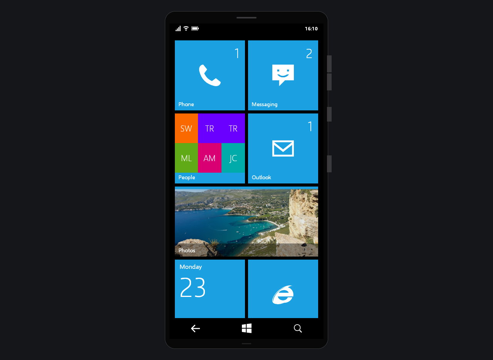

# Windows Phone

A Windows Phone 8.1 Update experience built with **FerroUI, Rust and declarative `rsx!` views**. The Start screen, apps, controls, navigation and data model run in FerroUI; portable host adapters supply storage, files, power observations and platform integrations.

[Open the app](https://ferroui.com/WindowsPhone/) · [App SDK](docs/sdk.md) · [Original references](docs/reference.md) · [Metro design evidence](docs/metro-design.md) · [Original emulator setup](docs/original-emulator.md) · [Architecture](docs/architecture.md) · [Host integration](docs/host-integration.md) · [Platform and shell architecture](docs/platform-architecture.md) · [Device integrations](docs/device-integration.md) · [Feature and fidelity status](docs/parity.md)

The reference release is **Windows Phone 8.1 Update (2014)**, including live folders and the original `system` / `applications` Settings pivots. This is a working app recreation, not an operating system or an emulator for XAP/APPX applications. **Complete visual and feature parity has not been established.** The [parity document](docs/parity.md) records the implemented workflows and the remaining differences.

## Shell and SDK parity follow-up

The current source continues the original Metro experience with continuous Start/Apps page slides, chronologically ordered local/native Action Center groups and shared grouped dismissal, a reusable native five-dot progress indicator, and retained cyclic Settings/Office hubs. Office search opens outside the Pivot gesture surface. A route-aware SDK pivot callback prevents Settings, Office and People detail pages from changing hidden hub selections. The new controls use the existing FerroUI pin; exact-source validation and remaining original-device comparison boundaries are recorded in [the follow-up verification record](docs/verification/metro-shell-sdk/README.md).

## Metro controls, navigation and Outlook drafts

The current source uses Microsoft's original Toolkit constants for position-sensitive tilt and forward/backward turnstile transitions. App and detail turnstiles retain one bounded, noninteractive image for the 250 ms outgoing phase, then enter the live destination over 350 ms; Start/Apps paging moves both surfaces concurrently. Route mutation and app disposal stay synchronous; interruption, privacy coverage, resize and motion suppression release the image. Native ToggleSwitch, CheckBox and RadioButton controls retain keyboard, selection and automation behavior through Metro templates and a render-owned `checked_state` binding; the square switch retains dragging. The checkbox uses the Toolkit ListPicker geometry with its license attribution, while pressed/disabled ink and persistent templates preserve native state across theme changes.

Date/time selectors now use a full phone presenter with large native wheels, staged values, done/cancel commands and the picker-specific 200 ms swivel. Hardware Back dismisses picker commands before the picker, and Home/navigation/lock close it without committing. TextBox phone styling preserves native editing, composition, selection and undo. Application bars separate four primary command slots from the ellipsis; expanded single-line captions and menus overlay the page and share Back/outside dismissal. Battery Saver, Data Sense and Games use a reusable native cyclic Pivot with independent scrolling panes and a reduced-motion fallback. Exact-revision verification below remains separate from the current source description.

The current development source adds Calendar tasks with optional foreground reminders, native missed-call counts and explicit acknowledgement, measured sticky headers for the native app catalog, and bounded recent previews for SDK apps. iOS owns a lifecycle-aware network-path observation and gains direct navigation-button qualification. The [feature implementation and preflight record](docs/verification/feature-completion/README.md) describes the contracts, tests and remaining execution boundaries; these source additions are separate from the published revision below.

Outlook adds a native multiline composer and versioned local drafts through SDK `AppStorage`. Save draft commits explicitly; Back can discard unsaved edits while preserving the saved copy. Drafts can be reopened and deleted, and unsaved editor text survives ordinary app switching. Open email requests the host mail app and leaves local state intact; it does not record a sent message or confirm delivery.

Confirmation dialogs use explicit, wrapping text commands, including `discard`, `delete`, `confirm` and `cancel`, with bounded touch targets. Application-bar label hiding is scoped to the actual collapsed bar; standalone actions keep their captions. Native regressions also cover palette replacement without losing switch template parts and Pivot snapping without inherited selection auto-scroll displacing the selected pane.

**Published browser revision: [`81fabb3`](https://github.com/FerroUI/WindowsPhone/commit/81fabb3fdfdeaae81792771a5c448c99b3e93fba).** The fresh main build passed **402 Rust tests** (one ignored), **77 JavaScript tests** and **93 rendered interaction groups**, producing **163 captures** with no recorded browser errors. All three full desktop builds, ARM Android packaging, Android emulator UI and iOS simulator checks passed. Pages deployed successfully; **40 public HTTP checks** verified the root page, all 38 precached files and the service worker against the tested artifact, including required delivery MIME types. The [main publication record](docs/verification/metro-followup/published/81fabb3/README.md) preserves exact source and artifact identities, the single Android dependency-download retry, and the later [correction of the iOS screenshot assessment](docs/verification/feature-completion/ios-navigation-correction.md). The [implementation dossier](docs/verification/metro-followup/README.md) explains the picker, bounded scrolling, application-bar and lifecycle fixes. Earlier [Metro refinement evidence](docs/verification/metro-refinement/README.md) retains its own source revisions and totals.

The [research record](docs/metro-design.md) separates original WP7/WP8 Toolkit behavior from the WP8.1 Update shell target. The [original-emulator investigation](docs/original-emulator.md) includes actual Windows setup attempts: Microsoft's authentic offline ISO installed the phone VHD, but vendor configuration required a restart and no XDE executable was available. **No original Windows Phone guest was booted.** Complete Panorama/continuum behavior, original selector physics, exact SDK brush values and matched original-device captures remain open.

## App and platform expansion

The default build now composes **28 registered apps in 52 workspace packages**, including new Podcasts and Wallet apps. The existing app crates add Office undo/redo and typed formulas, OneNote notebooks and checklists, playlists and photo albums, saved-place directions and multi-city forecasts. The [feature matrix](docs/parity.md#app-and-platform-expansion) distinguishes implemented workflows, verification and remaining platform/service limits.

## Portable application, launcher and shell hosts

The new [platform architecture](docs/platform-architecture.md) separates `phone-runtime`, shared `phone-native` services and replaceable OS providers. Android and iOS now have native FerroUI entry points and package workflows, alongside browser, Windows, macOS and Linux. **Device apps** adds native-app discovery, search, launch and Start pinning on supported hosts. Android has separate App/HOME APK flavors; Linux has an opt-in labwc login session; supported Windows editions have reviewable Shell Launcher configuration. iOS and browser accurately retain their application/embedded role.

Native files, networking, persistence, media and camera reuse FerroUI and the shared host. Platform plugins supply actual role state, settings, sharing, haptics, permissions and OS media controls. `NativeHost::compose` accepts SDK apps and explicit service replacements for embedding. See the [mode matrix and composition example](docs/platform-architecture.md#hosting-modes-and-actual-authority).

## Launcher, hardware and communication services

Android now implements shared contracts for default HOME, the default dialer and SMS/MMS roles, native contacts, notification actions, installed apps/shortcuts and real settings/hardware observations. The main All apps drawer combines phone apps with the native catalog. Quick settings expands beyond its four selected actions; Settings exposes typed controls, permissions and supported OS destinations. Controls distinguish writable values, system panels, consent and read-only state.

The same Phone, Messaging, People, Settings and Maps apps run on iOS. The standard build uses public Contacts, composition, hardware and MapKit APIs. An explicit `ios26-telephony` feature adds entitled LiveCommunicationKit/TelephonyMessagingKit integration; real signing, default-role and eligible device/region checks gate it. iOS does not advertise Home Screen replacement or privileged Android-style in-call control.

Start adds per-tile presentation, explicit arrangement/folder commands and six bounded notification templates with scoped SDK publishers. Maps now has an embedded retained tile viewport, pan/zoom, markers, attribution, HTTP-aware caching and typed saved-place pins. See [device integration and exact boundaries](docs/device-integration.md), including target verification and physical qualification.

## Preview

The earlier `41d7e3c` Metro refinement has reviewed originals for [narrow discard/cancel commands](docs/verification/metro-refinement/browser-41d7e3c/outlook-unsaved-back-confirmation.png), [restored multiline Outlook drafts](docs/verification/metro-refinement/browser-41d7e3c/outlook-restored-draft.png), [local drafts](docs/verification/metro-refinement/browser-41d7e3c/outlook-local-drafts.png), [dark](docs/verification/metro-refinement/browser-41d7e3c/metro-controls-320-dark.png) and [light](docs/verification/metro-refinement/browser-41d7e3c/metro-controls-320-light.png) phone controls, [the native player Pivot](docs/verification/metro-refinement/browser-41d7e3c/metro-pivot-native-player.png), and [expanded application-bar captions](docs/verification/metro-refinement/browser-41d7e3c/metro-app-bar-labels-overlay.png). The [visual review](docs/verification/metro-refinement/browser-41d7e3c/visual-review.md) binds these images to actual native snapshots and records the long-month picker and oversized-title clipping observed on that revision. Further source-attributed picker and application-bar captures are retained in the [follow-up dossier](docs/verification/metro-followup/README.md).

The verified browser revision [`77f0a0f`](https://github.com/FerroUI/WindowsPhone/commit/77f0a0f91a168e0f4c152cc59d762625a72f1382) provides reviewed captures of [six live-tile templates](docs/verification/launcher-native-integration/captures/start-live-templates.png), an [expanded live folder](docs/verification/launcher-native-integration/captures/start-folder-expanded-children.png), [embedded map pan/zoom](docs/verification/launcher-native-integration/captures/maps-native-tiles-pan-zoom.png) and [saved-place Start activation](docs/verification/launcher-native-integration/captures/maps-saved-place-start-activation.png). The [evidence index](docs/verification/launcher-native-integration/README.md) preserves their unmodified artifacts and exact fixture scope. Automated map captures use controlled tile imagery.

The browser renders the shared FerroUI control tree through WebAssembly. These unmodified captures come from the passing full browser verification of runtime [`01c4d69`](https://github.com/FerroUI/WindowsPhone/commit/01c4d697c6b32049c8b919899fbb0416f5b61144), with isolated sample data and native pointer, keyboard and touch input.



[Device apps and browser services](docs/screenshots/platform-device-browser.png) · [Mobile browser Start at 2× density](docs/screenshots/platform-start-mobile-browser.png)

Native host captures are also retained: [Android Start](docs/screenshots/platform-start-android.png), [Android Wallet](docs/screenshots/platform-wallet-android.png), [iOS Start](docs/screenshots/platform-start-ios.png) and [iOS Wallet](docs/screenshots/platform-wallet-ios.png). Their simulator/emulator source revisions and actual activation checks are recorded below.

Earlier application workflow captures retain their own source attribution: [Excel formulas/history](docs/screenshots/expansion-excel.png), [OneNote checklist](docs/screenshots/expansion-onenote.png), [Music playlist](docs/screenshots/expansion-music.png), [Weather forecast](docs/screenshots/expansion-weather.png), [Podcasts](docs/screenshots/expansion-podcasts.png), [320-pixel Wallet](docs/screenshots/expansion-wallet.png) and [Maps directions](docs/screenshots/expansion-maps.png).

[Capture provenance](docs/screenshots/README.md) identifies each build, artifact and unmodified image. The captures demonstrate the application; original-device pixel and motion parity has not been established.

## Explore

- **Start:** live content and notification counts, small/medium/wide tiles, pin/unpin, resize, reorder, folders that preserve their child tiles, secondary content tiles, accent colors, light/dark backgrounds, a shared scrolling photo behind transparent tile interiors, press-location tilt feedback, and the optional extra tile columns. Decorative motion respects reduced motion and Battery Saver.
- **Phone navigation:** swipe between Start and the alphabetical Apps list; search, measured letter jumps and sticky/push-off headings in both the built-in and virtualized native app lists; Back/Start/Search buttons; bounded recent-app previews for built-in and SDK apps; configurable lock wallpaper and status providers; grouped Action Center notifications and deep links.
- **System controls:** separate ringer/notification and media/app volume, mute and vibration controls; a hardware-style volume panel; light/dark and high-contrast themes; reduced motion; live-tile preferences; date order and calendar week start. Battery information uses an actual host reading when available; storage views measure the saved phone document and separately show browser-origin storage estimates and persistence permission.
- **Device apps:** discover, search, open and pin visible native applications on Android and supported desktop hosts. The page reports the current host mode and exposes supported system settings, Android HOME selection, haptics and notification consent. Browser and iOS show their available services.
- **Messaging and Outlook:** search local threads and mail, select rows from the left edge or a held item, and apply bulk actions. Messaging includes contact selection, unknown-number contact creation, drafts, and copy/forward/delete commands on individual messages. Outlook includes folders, all/unread/flagged views, bulk read/flag changes, deleted items and restore, plus a multiline composer and explicitly saved local drafts with reopen/delete. On supported mobile providers Messaging also exposes device threads, SMS/MMS transport, attachments, subscriptions and actual send states; the standard iOS path uses native composition. Open email hands composition to the host mail app without deleting the local draft or claiming delivery.
- **Calendar:** day, week, month and year navigation; inline month appointments and an hourly day view with separate columns for overlapping appointments; native date/time controls; all-day appointments, duration, reminders, status and notes; daily/weekday/weekly/biweekly/monthly/yearly repeats with an end date and individual-occurrence editing or deletion. Start and lock details use the same occurrence engine. Import/export supported local-time iCalendar files and share a saved appointment or series. The ellipsis menu opens tasks with optional due dates and reminders, priorities, notes, completion/reopening, search, filters, sorting, advance/postpone, confirmed deletion and pinned task tiles. Unsaved task edits survive app switching and require explicit discard.
- **Alarms and reminders:** native time/name/repeat/snooze editing, one-time and weekday alarms, foreground alert screens, configurable snooze and dismissal, and the original two-minute alarm snooze on Back. Calendar appointment and task reminders open their exact item; enabled SDK providers share the same bounded queue. Lock-screen privacy also covers the in-app reminder surface. The browser plays a synthetic tone using the saved ringer level when browser audio is available; permitted foreground alert banners can also appear through device notifications. Delivery requires the app to remain running.
- **Personal apps:** contacts and favorites, atomic vCard imports, contact-file copy/sharing, call history, a calculator, and OneNote notebooks/sections with page movement, native checklists, sharing and bounded UTF-8 TXT/Markdown import. Wallet stores local membership cards, tickets and offers with favorites, archiving, expiry dates, exact Code 39 display and JSON interchange.
- **Office and Files:** a persistent document library with folders, search, sorting, multi-selection, atomic file copy/move, rename, properties, file sharing and secondary Start tiles. New creates Word or Excel documents; existing supported PowerPoint presentations offer text and speaker-note editing. Word, Excel and PowerPoint share bounded undo/redo. Excel includes typed range selection, five AutoSum operations, workbook find, range clear, bounded single-key value sorting and a typed 43-function formula engine with lazy IF/IFERROR and validated XLSX formula caches. Native editors share real DOCX/XLSX/PPTX import/export; UTF-8 TXT and CSV imports are supported too. Complex unsupported Office structures are rejected, and imported supported OOXML files export or share as explicitly named mobile copies.
- **Media:** import photos, manage named albums and favorites, rename, zoom, share and capture from the camera. Music and Video add playlists, queue ordering, artist/album metadata browsing, search, shuffle/repeat and host-observed progress. Podcasts subscribes to or imports RSS/Atom feeds, streams HTTPS episodes, remembers playback across app switches and pins shows to Start. Browser Media Session and native Windows SMTC, macOS Now Playing and Linux MPRIS integrate transport commands. Embedded desktop media/camera and the separate foreground alarm player depend on platform permissions, renderer and codecs.
- **Web and services:** native browser tabs with independent Back/Forward journals, frequent sites and history, editable/pinnable favorites, and a configurable address-bar shortcut. Maps adds an embedded map with pan/zoom and saved markers, home/work, recent searches, city/coordinate search, saved-place pins and directions composition before explicit navigation-provider handoff. Weather saves up to ten cities, current/hourly/seven-day forecasts, units and freshness labels, with optional location-based current conditions. Web search, local Cortana-style commands and online-document links retain explicit host integrations.
- **Games and Store:** independent Tic tac toe and Minesweeper SDK apps with validated resumable games and persisted results. Tic tac toe offers a perfect phone opponent, two-player mode and unfinished-turn undo. Minesweeper offers three difficulties, safe opening areas, flags, chord reveal and best times. Games discovers registered game apps; Store enables, disables, pins and resets linked SDK apps. The original cloud Store and Xbox services are not connected.
- **App SDK:** immutable manifest registration, independent app routes, lifecycle/input hooks, typed app-owned session state, bounded JSON storage, data activation, custom live tiles, cancellable typed file/HTTPS tasks and a shared source-aware media queue/event channel. All built-in apps and the three Office editors live in separate crates. A scaffolder and compiled example show how to add another app without editing the system shell.
- **Persistence:** phone data stays in its host profile; browser media uses IndexedDB and desktop media uses app-owned files. Export and restore compatible JSON/media backups, including both wallpapers. Restore validates and saves before replacing live state; native restore preserves a recovery snapshot. The app includes installation/offline shell support. Settings can check for updates; a complete new build waits until every old app window closes, and separate hosted app scopes own separate caches.

The first run contains fictional example contacts, messages, mail, notes and photos so the phone has something useful to explore. These are local sample data, not a signed-in account or a simulated live inbox.

## Interaction

| Action | How |
| --- | --- |
| Open all apps | Swipe left from Start or use its app-list arrow. |
| Return to Start | Press the Windows button. |
| Go back | Press Back; dismiss menus and detail views before leaving an app. |
| See recent apps | Hold Back; right-click also opens its context action on a desktop. |
| Arrange Start | Hold a tile to select it; resize/unpin or drag it to another position. |
| Make a folder | Drop a held tile onto another tile. |
| Read notifications | Pull down from the status bar, or tap the status bar. |
| Adjust volume | Use the desktop phone frame's volume buttons, or Settings → ringtones+sounds → show volume controls. Expand the panel to adjust both channels. |
| Select mail or threads | Tap the left selection rail, hold a row, or choose select in the application bar. |
| Work with a message | Hold or right-click its bubble to copy, forward or delete it. |
| Restore deleted mail | Open Outlook → more → folders → deleted items, select a message, then more → move to inbox. The same command is available in its detail view. |
| Save or reopen an email draft | In Outlook choose new, enter text, then save draft. Open more → drafts to edit a saved copy; deletion asks for confirmation. Back asks before discarding unsaved changes. |
| Change app section | Select a pivot heading or swipe horizontally on a supported pivot surface. |
| Change Calendar period | Choose day/week/month/year with view, then swipe horizontally; tap a month in year view or a day in week/month view to inspect appointments. |
| Edit a recurring appointment | Open its details, choose edit or delete, then select this appointment or the entire series. |
| Manage Calendar tasks | Open Calendar → more → tasks. Use new to enter a task; hold a task for completion, rescheduling and deletion commands. Open its details to edit or pin it. |
| Acknowledge missed calls | Open Phone → history and use acknowledge missed calls. The command preserves missed-call history and leaves calls that arrived after the displayed selection unacknowledged. Android requires current call-log access and the default dialer role. |
| Snooze an alert | Select a snooze duration on the alert, then snooze; Back snoozes an alarm for two minutes and a Calendar reminder for five. |
| See more commands | Use the application bar's ellipsis. |
| Import contacts or appointments | Open People or Calendar, then more → import contacts or import appointments. |
| Share a contact or appointment | Open its details, then more → share contact, share appointment or share series. The desktop host saves an attachment copy. |
| Allow device banners | Open Settings → notifications+actions → Device notifications → allow device notifications. The host operating system or browser owns the permission decision. |
| Keep browser data | Open Settings → storage sense → Device app storage → keep app data on this device, where the browser supports persistence requests. |
| Import other personal content | Use the relevant app's add command; file selection stays under your control. |

When the host delivers the shortcut to the app, **Home** opens Start, **Backspace/Escape** go back, **Ctrl/Cmd+F** opens search, and **Ctrl/Cmd+L** toggles the in-app lock. Editing controls keep their normal text-editing keys. Browsers can reserve some shortcuts for their own interface.

## Build

FerroUI is pinned as a Git submodule. Initialize it before running Cargo:

```bash
git clone --recurse-submodules https://github.com/FerroUI/WindowsPhone.git
cd WindowsPhone
git submodule update --init --recursive
```

The repository's Rust toolchain and dependency versions follow the pinned FerroUI revision. Do not independently upgrade `wasm-bindgen`, the Emscripten SDK, or the Rust browser target; they must agree with the framework's browser setup.

### Browser

Install Node.js 24 and the framework's pinned browser tools, then build:

```bash
bash FerroUI/scripts/browser/setup.sh "$HOME/browser-tools"
source "$HOME/browser-tools/env.sh"
bash scripts/build-browser.sh
```

The resulting static app is in `target/browser/phone-browser`. Serve that directory over HTTP; camera and installation features need a secure context, such as HTTPS or localhost:

```bash
python3 -m http.server 8080 --directory target/browser/phone-browser
```

### Desktop

```bash
cargo run --release -p phone-desktop
```

The desktop host uses the same shell, app crates, state and theme. Native FerroUI pickers support Office documents, vCard contacts, iCalendar appointments, photos, music, video, SDK file selections and compatible media backups. Embedded audio/video and camera use FerroUI's platform media providers. Native adapters supply one-shot location, explicit weather requests, device notification banners and foreground alarm audio. Sharing saves actual attachment copies through native pickers; it does not confirm delivery to another app. Restoring a backup preserves a recovery snapshot and requires a successful save before replacing live state. Windows, macOS and Linux power adapters report optional battery observations.

See [native prerequisites and macOS packaging](crates/phone-desktop/platform/README.md), including Linux GStreamer/EGL/PipeWire requirements and the macOS `.app` bundle needed for consent. Native OS media sessions are implemented; desktop haptics and background alarm wake-up remain outstanding. The [platform matrix](docs/host-integration.md) separates implemented adapters from device verification.

### Android and iOS

The native mobile hosts use the same apps and `phone-native` composition as desktop. Follow the [Android prerequisites](crates/phone-android/README.md) for the pinned JDK, Gradle, Android SDK/NDK and Rust target, then build the ordinary application and separate HOME flavor:

```bash
bash scripts/build-android.sh
bash scripts/build-android.sh --launcher --no-cargo
```

Both ARM64 APKs are written beneath `target/android/phone-arm64-v8a-debug/outputs/apk`. The ordinary application has no HOME intent category. Installing the Launcher APK makes it an eligible launcher; becoming the selected HOME app still uses Android's own role chooser.

On macOS with Xcode and an installed simulator runtime:

```bash
rustup target add aarch64-apple-ios-sim
bash scripts/build-ios.sh --target aarch64-apple-ios-sim
bash scripts/smoke-ios.sh target/ios-bundles/phone-ios.app
```

The [iOS host guide](crates/phone-ios/README.md) also covers device builds and embedding. The simulator bundle is signed ad hoc; a physical-device bundle requires your signing identity and provisioning profile. iOS uses an ordinary UIKit application with its public platform integrations. Build the optional carrier provider with `--features ios26-telephony`; the feature does not grant required signed entitlements or default roles.

### Build an SDK app

```bash
python scripts/new-phone-app.py phone-app-counter --title Counter --id example.counter
cargo check -p phone-app-counter
```

Add the generated crate as a dependency of your composition, then pass its registration to `phone_ui::create_view_with_apps(vm, vec![phone_app_counter::registration()])`. The checked-in `phone-app-sdk-example` demonstrates this architecture without adding the example to the default app list. The [SDK guide](docs/sdk.md) covers declarative views, storage schemas, lifecycle, capability declarations, file tasks and live tiles.

### Checks

```bash
cargo test --locked -p phone-host -p phone-domain -p phone-state
cargo test --locked -p phone-sdk -p phone-controls -p phone-app-support -p phone-media-support
cargo test --locked -p phone-app-weather -p phone-app-maps -p phone-app-podcasts -p phone-app-wallet -p phone-app-onenote -p phone-app-photos
cargo test --locked -p phone-app-cortana -p phone-app-tic-tac-toe -p phone-app-minesweeper
cargo test --locked -p phone-app-outlook -p phone-system -p phone-app-alarms
cargo check --locked -p phone-desktop -p phone-app-sdk-example
node --test scripts/*.test.mjs
```

The Tic tac toe solver test explores every human move sequence against the phone's minimax player. Minesweeper tests cover safe openings, expansion, flags and restored-board validation. SDK tests cover stable reactive ownership, lifecycle ordering, capability refusal, bounded storage, file-task cancellation and stale completion after restore. Domain and state tests cover persistent-data validation, tile layout, navigation and mutations. Office cases cover supported OOXML roundtrips, bounded parsing, formula evaluation, atomic library changes and document activation. These checks do not establish pixel parity or validate every physical device.

With Chromium available, run the browser interaction and screenshot suite against a packaged build:

```bash
node scripts/ui-smoke.mjs target/browser/phone-browser target/ui-smoke
```

### Launcher and device integration verification

The browser passed [run 45282852497](https://github.com/FerroUI/WindowsPhone/actions/runs/45282852497) at [`77f0a0f`](https://github.com/FerroUI/WindowsPhone/commit/77f0a0f91a168e0f4c152cc59d762625a72f1382): **331 Rust tests**, **55 JavaScript tests** and **71 rendered interaction groups**, producing **132 captures** with **zero console/runtime errors**. The **215.695-second** duration measures the rendered suite. [Browser evidence](docs/verification/launcher-native-integration/browser.json) and [unmodified results](docs/verification/launcher-native-integration/results.json) retain exact source and artifact hashes.

| Desktop target | Host / plugin / shared native tests | Additional gates | Full build/link |
| --- | --- | --- | --- |
| Linux | 33 / 9 / 17 passed | 6 packaging tests; separate private-D-Bus MPRIS test | Passed |
| Windows | 30 / 6 / 16 passed | 4 packaging tests, 2 POSIX-only skips; PowerShell parser | Passed |
| macOS | 29 / 5 / 17 passed | 6 packaging tests | Passed |

[Desktop evidence](docs/verification/launcher-native-integration/desktop.json) records actual native media-provider compilation, protocol checks and complete executable links. It does not establish physical hardware, native permission dialogs, rendered desktop interaction or installation as the user's shell. The [local record](docs/verification/launcher-native-integration/local-validation.json) keeps overlapping ownership, contract, cache and lifecycle regressions separate.

The browser was deployed successfully. [Direct HTTP checks](docs/verification/launcher-native-integration/publication-http.json) returned `200` and `77f0a0f` from both [the public app](https://ferroui.com/WindowsPhone/) and its scope-owned service worker. These checks establish the served revision; existing-profile upgrade behavior remains bounded by the service worker's waiting lifecycle.

### Earlier Android native qualification (77f0a0f)

At [`77f0a0f`](https://github.com/FerroUI/WindowsPhone/commit/77f0a0f91a168e0f4c152cc59d762625a72f1382), the [ARM64 package gate](https://github.com/FerroUI/WindowsPhone/actions/runs/45282852656) passed both actual App/HOME APKs, no-default-feature embedding, 111 JVM assertions, 24 AOSP source hashes, protected merged manifests, exported JNI and 16 KiB ELF/ZIP alignment. The independent [API 36 runtime gate](https://github.com/FerroUI/WindowsPhone/actions/runs/45282852605) passed both flavors, actual HOME selection/reentry/Back, native unread SMS and its cold Start badge, native notification grant/admission/rendering/revocation, and incoming-call Answer plus foreground ownership and remote-end teardown. Original roles and notification-listener state were restored in the disposable emulator.

[Package evidence](docs/verification/launcher-native-integration/android-package.json), [runtime evidence](docs/verification/launcher-native-integration/android-ui.json), and [reviewed original captures](docs/verification/launcher-native-integration/README.md#android-launcher-and-communications-runtime) preserve the exact conditions. The call gate uses native Answer input and modem-simulated remote hangup; it does not establish End-call button input or physical carrier delivery. MMS codec tests make no RF requests. Native hardware, physical OEM policies, chooser consent/denial and carrier MMS remain device qualification work.

### Earlier iOS native qualification (9a628e3)

At [`9a628e3`](https://github.com/FerroUI/WindowsPhone/commit/9a628e39af18b727555ad4f9a5184761d2519502), the [iOS gate](https://github.com/FerroUI/WindowsPhone/actions/runs/45287778966) passed both standard/optional UIKit builds, physical-iPhone Swift type checking, real Contacts create/query/update/query/delete/query, truthful simulator brightness observation/write refusal, and six system-delivered URLs covering Wallet, Phone, People, Messaging, Settings and Home. All seven mounted observations retain the same process, launch UUID and active scene with a **414 × 814-point** phone surface inside the observed safe area. Settings accepts its owned detail-route redirect.

[That iOS record](docs/verification/launcher-native-integration/ios.json) and [original native observations/captures](docs/verification/launcher-native-integration/README.md#ios-uikit-and-native-integration) retain the exact boundaries. The simulator does not qualify carrier service, physical brightness or distribution signing. An intermittent initial-startup failure in earlier attempts remains unexplained; opt-in early diagnostics were added, and that complete run passed with unchanged runtime deadlines and provider assertions. [Target source fingerprints](docs/verification/launcher-native-integration/source-boundaries.json) bind each separate passing platform revision to unchanged applicable source at that release’s recorded implementation head.

### Earlier portable browser and desktop verification

Browser runtime [`01c4d69`](https://github.com/FerroUI/WindowsPhone/commit/01c4d697c6b32049c8b919899fbb0416f5b61144) passed [run 45211399089](https://github.com/FerroUI/WindowsPhone/actions/runs/45211399089) and deployed to [the public app](https://ferroui.com/WindowsPhone/). It passed **260 Rust tests**, **51 JavaScript tests**, linking of **25 local modules**, and **66 rendered interaction groups** with **125 captures** and **zero console/runtime errors**. The **189.052-second** duration measures the suite. New groups exercise Device apps against observed browser support and reject unsupported platform requests and invalid activation routes without changing phone data. [Results](docs/verification/01c4d69-results.json) and the [browser publication record](docs/verification/01c4d69-browser.json) retain the exact source and artifact hashes.

Native adapters at [`4ae5558`](https://github.com/FerroUI/WindowsPhone/commit/4ae5558e20902eec7244b6edd2238b80e42334e2) passed [run 45208195282](https://github.com/FerroUI/WindowsPhone/actions/runs/45208195282), including complete desktop executable links with actual platform media providers:

| Platform | Host / desktop plugin / shared native tests | Additional checks | Full build/link |
| --- | --- | --- | --- |
| Linux | 26 / 9 / 16 passed | 6 packaging tests; separate private-bus MPRIS test | Passed |
| Windows | 23 / 6 / 15 passed | 4 packaging tests, 2 POSIX-only skips; PowerShell parser | Passed |
| macOS | 22 / 5 / 16 passed | 6 packaging tests, including Python 3.15 compatibility | Passed |

[Native evidence](docs/verification/4ae5558-native.json) separates compile/protocol checks from physical devices, OS permission prompts and actually installing a login/shell session. The [local checkpoint](docs/verification/bc4bbaa-local.json) adds focused runtime, cancellation, ownership and foreground-alarm regressions; overlapping counts are kept separate.

Public HTTP confirmed `01c4d69` in both the page and the scope-owned service-worker revision. Settings → phone update checks for a new build. A downloaded update becomes active after **all old app windows and tabs close**; an ordinary refresh can retain the prior worker while another old window remains open.

### Earlier native mobile verification

Android ARM64 revision [`6149938`](https://github.com/FerroUI/WindowsPhone/commit/6149938d9bf8eb8cf3cf5eeb620c3aee124132df) passed [run 45218700649](https://github.com/FerroUI/WindowsPhone/actions/runs/45218700649): both actual App/Launcher APKs, the library with its standalone entry disabled, merged package manifests, exported `JNI_OnLoad`, and **16 KiB ELF and APK ZIP alignment**. [The package record](docs/verification/6149938-android.json) retains the APK hashes and tool versions; [ARM64 debug packages](https://github.com/FerroUI/WindowsPhone/actions/runs/45218700649/artifacts/14839923081) are attached to that run.

The separate Android 36 x86_64 emulator gate passed [run 45222094681](https://github.com/FerroUI/WindowsPhone/actions/runs/45222094681) at [`895b47e`](https://github.com/FerroUI/WindowsPhone/commit/895b47e2cb969fd7069fd056f180a6b1366d9e93). Both variants completed **Start → Wallet → Home** through real activity intents, with visible mounted controls, fresh observations and the exact activity focused. All six captures measured a **360 × 720** client with **68 dp top / 24 dp bottom insets** and a **360 × 628** phone surface. The current user and selected HOME app remained unchanged. The Launcher package accurately stayed in app mode while its HOME role was only available. [The runtime record](docs/verification/895b47e-android-ui.json) contains all six reviewed captures' hashes, geometry, package verification and the corrected diagnostic-query history; selected [native Start](docs/screenshots/platform-start-android.png) and [Wallet](docs/screenshots/platform-wallet-android.png) images are retained in the repository.

This Android runtime gate verifies mounted layout and real activation on the stated emulator. Physical/OEM devices, HOME-role consent, Activity recreation and native hardware/permission interactions remain separate qualification work. The [Android guide](crates/phone-android/README.md) provides both package and emulator commands.

iOS revision [`5b41a55`](https://github.com/FerroUI/WindowsPhone/commit/5b41a557c83c59ea864c878199065f4dba07f5c9) passed [run 45223785634](https://github.com/FerroUI/WindowsPhone/actions/runs/45223785634), including the actual `aarch64-apple-ios-sim` executable and Objective-C bridges, portable completion tests, observation-boundary tests and public XCTest automation. UIKit completed **Start → Wallet → Home** with exact accepted URLs, fresh observations and the expected visible page controls. The **414 × 896-point** client reported **48 top / 34 bottom** safe-area insets; the inner host, PhoneScreen and view-model viewport measured **414 × 814**. All three unmodified captures were reviewed, including identical status/navigation glyph pixels across the transitions. [The iOS record](docs/verification/5b41a55-ios.json) retains the proofs, hashes and earlier safe-area/confirmation/startup-budget corrections. The [simulator bundle](https://github.com/FerroUI/WindowsPhone/actions/runs/45223785634/artifacts/14845035654) and [UI evidence](https://github.com/FerroUI/WindowsPhone/actions/runs/45223785634/artifacts/14845270139) are attached to the run. This is simulator qualification; physical-device permissions, media/camera/haptics and distribution signing require their own device/deployment checks.

The [source comparison record](docs/verification/platform-source-boundaries.json) verifies that each target's compiled source and relevant configuration remain identical to its named passing revision at that release’s recorded implementation head. Later mobile-only commits do not expand the earlier browser/desktop claims or change their verified source.

### Earlier app expansion release

Runtime [`7bc4107`](https://github.com/FerroUI/WindowsPhone/commit/7bc41077ae1dd8762071cf8af2f1602ea9390ff7) passed [run 45181127412](https://github.com/FerroUI/WindowsPhone/actions/runs/45181127412) and deployed to [the public app](https://ferroui.com/WindowsPhone/). The browser gate passed **230 Rust tests**, **40 JavaScript tests** and **23 linked local modules**. Full rendered verification passed **64 interaction groups**, produced **124 captures**, and recorded **zero console/runtime errors** in **213.079 seconds**. This duration measures the suite, not startup latency or frame rate.

The expanded flows cover typed Excel formulas and Office history, OneNote section/checklist persistence, media playlists and photo albums, Podcasts feed/episode actions, Weather forecasts and units, narrow Wallet barcodes/pivots, saved-place Maps directions, and the existing shell, touch, density and offline reload checks. [Retained results](docs/verification/7bc4107-results.json), [eight reviewed captures](docs/screenshots/README.md#current-app-expansion-7bc4107) and the [publication record](docs/verification/7bc4107-publication.json) retain their exact source attribution.

The preceding [integrated run 45178205829](https://github.com/FerroUI/WindowsPhone/actions/runs/45178205829) on `6518960` passed the full browser suite and all three native jobs: **23 Linux**, **20 Windows** and **19 macOS host tests**, complete desktop build/link on each platform, and a separate real isolated Linux MPRIS protocol test. The final `7bc4107` follow-up adds persistent Maps field labels and improves that existing UI capture; native adapter code is identical. [Native evidence](docs/verification/6518960-native.json) distinguishes compile/protocol coverage from physical hardware and OS permission testing.

Public HTTP confirmed `7bc4107` in the served page and scope-owned service-worker cache revision. Settings → phone update checks for a new build. A downloaded update waits until **all old app windows and tabs close**; reopening then allows the new worker to take over. An ordinary refresh can keep the previous worker while another app window remains open.

### Earlier SDK release

The earlier [complete verification run 45163782836](https://github.com/FerroUI/WindowsPhone/actions/runs/45163782836) for [`cec2d1d`](https://github.com/FerroUI/WindowsPhone/commit/cec2d1d214310e33ef4908949fd3d6fe647630a9) passed **161 Rust tests**, **25 JavaScript tests**, linking of **21 packaged local modules**, and the native mobile first-frame check. Its full browser suite passed **53 interaction groups**, produced **104 captures**, and recorded **zero console/runtime error entries**. The suite's **165.364-second** duration measures verification time, not startup latency or frame rate.

The checks drive native input through Cortana discovery and local app-opening commands, reject disabled game discovery, verify exact saved boards and scores, reload and restore data, and exercise Start pinning and Store disable/re-enable. Cell-pixel assertions require visible flags before and after reload and full-color completed X/O marks. Existing Office, Files, Calendar, foreground alarms, live tiles, host byte callbacks, touch, density and offline checks remain in the suite. The [artifact](https://github.com/FerroUI/WindowsPhone/actions/runs/45163782836/artifacts/14812709655), [retained results](docs/verification/cec2d1d-results.json) and [six reviewed captures](docs/screenshots/README.md#earlier-sdk-app-verification-cec2d1d) identify the evidence.

<!-- BEGIN SDK LATEST RELEASE STATUS -->
The same run's [browser build](https://github.com/FerroUI/WindowsPhone/actions/runs/45163782836/job/137655455056), [Pages deployment](https://github.com/FerroUI/WindowsPhone/actions/runs/45163782836/job/137662122359) and all three native jobs succeeded. Native verification passed **16 Linux**, **14 macOS** and **15 Windows host tests**, then built and linked the complete desktop executable on each platform with real media/camera providers. Public HTTP confirmed `cec2d1d` in the index and `windows-phone-cec2d1d` in the service worker. The [publication record](docs/verification/cec2d1d-publication.json) keeps the browser, native, local and HTTP evidence distinct.
<!-- END SDK LATEST RELEASE STATUS -->

The earlier [73dc39f browser record](docs/verification/73dc39f-results.json) documents the original symbol-rendering correction, while the [9c392ef record](docs/verification/9c392ef-publication.json) preserves the singular-label release and successful Windows cold-build verification. Historical captures remain linked to their original source revision.

The [local extraction checkpoint](docs/verification/d8f3d03-local.json) at [`d8f3d03`](https://github.com/FerroUI/WindowsPhone/commit/d8f3d03c8b6604e12361aebcd9ecd7430e9f9bd1) passed **179 Rust tests** across all non-browser workspace packages, plus **25 JavaScript tests**. Local Linux media/camera compilation used unavailable-provider bridges because development libraries were absent; the separate native CI installs real platform dependencies. Neither compilation nor these tests demonstrate physical camera/audio hardware, OS consent dialogs, notification delivery, closed-app alarm wake-up or original-device visual parity. [The parity record](docs/parity.md#sdk-games-and-native-adapter-implementation) separates each revision and verification scope and retains the older release evidence.

## GitHub Pages

The `Build and publish` workflow runs on application changes pushed to `main` and can also be started manually. It uses the pinned FerroUI browser toolchain, restores dependency caches, runs focused state/host checks, builds one browser target, validates the packaged module graph and first native frame, uploads the static app, and deploys it to GitHub Pages. Documentation-only pushes do not rebuild. Routine publication has no platform matrix or separate lint workflow.

Rendered desktop/touch smoke checks and their screenshot artifact are opt-in: enable `verify_ui` for a manual run, or include `[verify-ui]` in the pushed commit message. This keeps routine publication lean while retaining an explicit visual verification path.

Native verification is also opt-in: the `verify_native` manual input or a `[native-only]` push marker runs Windows, macOS and Linux host checks without rebuilding Pages. Use the native-only path for platform-specific adapter changes; its independent concurrency group preserves an in-progress browser release. A `[verify-native]` push marker adds the native matrix to a browser release. The Linux check installs media development libraries so it compiles the full native bridges. These jobs build and link the complete desktop executable and run portable host tests; they do not open permission dialogs or exercise physical hardware. Native caches retain the compiler and exact framework pin boundary while reusing unchanged dependencies across app manifest updates. Windows additionally pins the compatible Windows 2022 runner and verifies LLVM against the MSVC standard library before compiling; its cache retains that runner boundary.

Mobile gates use `[verify-mobile]` for both Android and iOS, or `[verify-android]` / `[verify-ios]` for one target. Add `[mobile-only]` to suppress unrelated browser and desktop jobs. A skipped mobile run cannot cancel an active verification on the other platform. Android preserves the assembled APKs and decoded manifests even when a later package check fails, and its native build cache is saved before package validation.

For test or documentation changes, a manual run can set `reuse_run` to a completed main-branch run with a `compiled-app` artifact. The workflow checks the source repository, workflow, commit and runtime input trees before downloading that artifact. Reuse still runs host checks, module-link validation and the full browser suite before publication; changes to application sources or the FerroUI pin require a normal build.

Set `publish` to `false` for a manual verification run that retains its test artifacts without deploying to Pages. Push-triggered runs publish after their checks succeed.

Set the repository's **Settings → Pages → Build and deployment → Source** to **GitHub Actions** if it is not already configured. The workflow also requests Pages enablement. The app is published through the organization's Pages domain at:

**https://ferroui.com/WindowsPhone/**

The successful deployment run is the source of truth for publication; a source commit alone does not establish that the site is live.

## Project layout

| Crate | Responsibility |
| --- | --- |
| `phone-host` | UI-independent host contracts, permissions/observations, URI validation, native paths, atomic files, power adapters and bounded background work. |
| `phone-domain` | Serializable phone document, app catalog, tile packing, calendar and calculator logic, validation. |
| `phone-state` | ReactiveUI view model and commands, navigation journal, DynamicData projections, persistence boundary. |
| `phone-controls` | Trimmed WinUI base, Metro control templates, palette, typography, vector icons and reusable app bars. |
| `phone-fonts` | Embedded Microsoft Selawik font collection, four weights, licensing and shared host registration. |
| `phone-sdk` | Manifest/registry contracts, contexts, typed session state, bounded app storage, lifecycle hooks, typed host tasks and reusable page helpers. |
| `phone-system` | Shared `rsx!` system shell, Start/app list, lock screen, notifications, hardware panels, previews and gestures. |
| `phone-alarm-service` | Reusable foreground alarm/reminder scheduling and alert/editor state. |
| `crates/apps/phone-app-*` | Separate built-in apps, Word/Excel/PowerPoint editors, shared app support, independent games and SDK example. |
| `phone-ui` | Default app composition and compatible host-facing facade; no embedded app implementations. |
| `phone-browser` | FerroUI browser startup, WebAssembly exports, browser services and static/PWA assets. |
| `phone-runtime` | Explicit providers, platform capabilities, bounded request/lifecycle ownership and activation. |
| `phone-native` | Shared native persistence/recovery, pickers, documents, networking, media/camera and embedding composition. |
| `phone-platform-desktop` | Windows/macOS/Linux app catalogs, activation, settings and observed shell-session policy. |
| `phone-desktop` | Window/renderer/lifetime composition and app/launcher/shell modes. |
| `phone-android` | Native application and HOME flavors, Android OS/services/media and embeddable bootstrap. |
| `phone-ios` | UIKit/Metal application, iOS OS/services/media and simulator bundle. |

Read [architecture](docs/architecture.md) for the state, rendering and service boundaries, and [parity](docs/parity.md) before assuming original phone capabilities are available.

## Fonts and attribution

The original design uses Segoe WP. The theme requests Segoe WP or Segoe UI when the host provides a licensed system copy, then falls back to bundled **Microsoft Selawik 1.01** and FerroUI's Inter. The `phone-fonts` crate embeds unmodified Light, Regular, Semibold and Bold Selawik files under the SIL Open Font License 1.1. Microsoft describes Selawik as an open replacement for Segoe UI and records outstanding kerning and hinting differences; the font is not a claim of Segoe WP pixel parity. See [font provenance and license](crates/phone-fonts/NOTICE.md). Original interface research and source links are collected in [the reference document](docs/reference.md). Third-party component and bundled asset notices are in [NOTICE.md](NOTICE.md) and the FerroUI submodule.

Windows Phone, Lumia, Microsoft, Cortana and related names identify the referenced products. This project is an independent recreation and is not an official Microsoft product.
