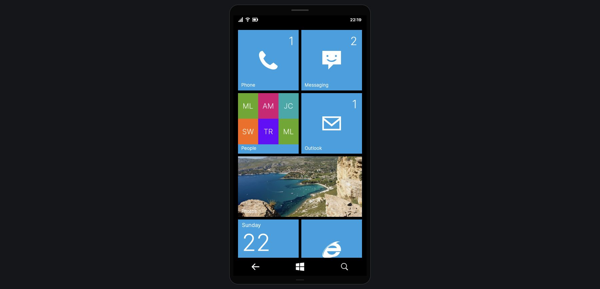

# Windows Phone

A Windows Phone 8.1 Update experience built with **FerroUI, Rust and declarative `rsx!` views**. The Start screen, apps, controls, navigation and data model run in FerroUI; the browser host supplies storage, camera, media, sharing and web integration.

[Open the app](https://ferroui.com/WindowsPhone/) · [Original references](docs/reference.md) · [Architecture](docs/architecture.md) · [Feature and fidelity status](docs/parity.md)

The reference release is **Windows Phone 8.1 Update (2014)**, including live folders and the original `system` / `applications` Settings pivots. This is a working app recreation, not an operating system or an emulator for XAP/APPX applications. **Complete visual and feature parity has not been established.** The [parity document](docs/parity.md) records the implemented workflows and the remaining differences.

## Preview

The browser renders the retained FerroUI control tree through WebAssembly. The desktop Start capture comes from the published app; the mobile capture comes from the full browser verification run.



[Mobile Start screenshot](docs/screenshots/start-refined-mobile.png) · [Phone history screenshot](docs/screenshots/phone-history.png)

The refinement suite also captures real native Office, Files and system workflows: [Word](docs/screenshots/refinement-word.png), [Excel](docs/screenshots/refinement-excel.png), [PowerPoint](docs/screenshots/refinement-powerpoint.png), [Files](docs/screenshots/refinement-files.png) and [volume controls](docs/screenshots/refinement-volume.png). [Capture provenance](docs/screenshots/README.md) distinguishes published-app captures from the isolated browser verification fixtures.

## Explore

- **Start:** live content and notification counts, small/medium/wide tiles, pin/unpin, resize, reorder, folders that preserve their child tiles, secondary content tiles, accent colors, light/dark backgrounds, a shared scrolling photo behind transparent tile interiors, press-location tilt feedback, and the optional extra tile columns. Decorative motion respects reduced motion and Battery Saver.
- **Phone navigation:** swipe between Start and the alphabetical Apps list; search, measured letter jumps and sticky group headings; Back/Start/Search buttons; recent-app cards; configurable lock wallpaper and status providers; grouped Action Center notifications and deep links.
- **System controls:** separate ringer/notification and media/app volume, mute and vibration controls; a hardware-style volume panel; light/dark and high-contrast themes; reduced motion; live-tile preferences; date order and calendar week start. Battery information uses an actual host reading when available; storage views measure the saved phone document.
- **Messaging and Outlook:** search local threads and mail, select rows from the left edge or a held item, and apply bulk actions. Messaging includes contact selection, unknown-number contact creation, drafts, and copy/forward/delete commands on individual messages. Outlook includes folders, all/unread/flagged views, bulk read/flag changes, deleted items and restore. Compose actions explicitly open the host's messaging or email app; local drafts do not claim delivery.
- **Calendar:** day, week, month and year navigation; inline month appointments and an hourly day view with separate columns for overlapping appointments; native date/time controls; all-day appointments, duration, reminders, status and notes; daily/weekday/weekly/biweekly/monthly/yearly repeats with an end date and individual-occurrence editing or deletion. Start and lock details use the same occurrence engine.
- **Alarms and reminders:** native time/name/repeat/snooze editing, one-time and weekday alarms, foreground alert screens, configurable snooze and dismissal, and the original two-minute alarm snooze on Back. A Calendar reminder opens its occurrence. The browser plays a synthetic tone using the saved ringer level when browser audio is available; delivery requires the app to remain running.
- **Personal apps:** contacts and favorites, call history, notes, and a calculator.
- **Office and Files:** a persistent document library with folders, search, sorting, multi-selection, atomic file copy/move, rename, properties, file sharing and secondary Start tiles. New creates Word or Excel documents; existing supported PowerPoint presentations offer text and speaker-note editing. Excel includes typed range selection, five AutoSum operations, workbook find, range clear and bounded single-key value sorting. Native editors share real DOCX/XLSX/PPTX import/export; UTF-8 TXT and CSV imports are supported too. Complex unsupported Office structures are rejected, and imported supported files export or share as explicitly named mobile copies.
- **Media:** import photos, browse the Camera Roll, select favorites, zoom, share, and delete; capture from the camera; import audio and video and play them through browser media APIs.
- **Web and services:** native browser tabs with independent Back/Forward journals, frequent sites and history, editable/pinnable favorites, and a configurable address-bar shortcut. Web search, OpenStreetMap handoff, current weather after location permission, local Cortana-style search and commands, and online-document links use explicit host integrations.
- **Games and Store:** a playable tic-tac-toe game and management of the included app collection. The original cloud Store and Xbox services are not connected.
- **Persistence:** phone data remains in the current browser; media uses IndexedDB. Export and restore a JSON backup, including imported media. The app includes a manifest and service worker for installation and offline shell use.

The first run contains fictional example contacts, messages, mail, notes and photos so the phone has something useful to explore. These are local sample data, not a signed-in account or a simulated live inbox.

## Interaction

| Action | How |
| --- | --- |
| Open all apps | Swipe left from Start or use its app-list arrow. |
| Return to Start | Press the Windows button. |
| Go back | Press Back; dismiss menus and detail views before leaving an app. |
| See recent apps | Hold Back; right-click also opens its context action on a desktop. |
| Arrange Start | Hold a tile to select it; resize/unpin or drag it to another position. |
| Make a folder | Drop a held tile onto another tile. |
| Read notifications | Pull down from the status bar, or tap the status bar. |
| Adjust volume | Use the desktop phone frame's volume buttons, or Settings → ringtones+sounds → show volume controls. Expand the panel to adjust both channels. |
| Select mail or threads | Tap the left selection rail, hold a row, or choose select in the application bar. |
| Work with a message | Hold or right-click its bubble to copy, forward or delete it. |
| Restore deleted mail | Open Outlook → more → folders → deleted items, select a message, then more → move to inbox. The same command is available in its detail view. |
| Change app section | Select a pivot heading or swipe horizontally on a supported pivot surface. |
| Change Calendar period | Choose day/week/month/year with view, then swipe horizontally; tap a month in year view or a day in week/month view to inspect appointments. |
| Edit a recurring appointment | Open its details, choose edit or delete, then select this appointment or the entire series. |
| Snooze an alert | Select a snooze duration on the alert, then snooze; Back snoozes an alarm for two minutes and a Calendar reminder for five. |
| See more commands | Use the application bar's ellipsis. |
| Import personal content | Use the relevant app's add command; file selection stays under your control. |

When the host delivers the shortcut to the app, **Home** opens Start, **Backspace/Escape** go back, **Ctrl/Cmd+F** opens search, and **Ctrl/Cmd+L** toggles the in-app lock. Editing controls keep their normal text-editing keys. Browsers can reserve some shortcuts for their own interface.

## Build

FerroUI is pinned as a Git submodule. Initialize it before running Cargo:

```bash
git clone --recurse-submodules https://github.com/FerroUI/WindowsPhone.git
cd WindowsPhone
git submodule update --init --recursive
```

The repository's Rust toolchain and dependency versions follow the pinned FerroUI revision. Do not independently upgrade `wasm-bindgen`, the Emscripten SDK, or the Rust browser target; they must agree with the framework's browser setup.

### Browser

Install Node.js 24 and the framework's pinned browser tools, then build:

```bash
bash FerroUI/scripts/browser/setup.sh "$HOME/browser-tools"
source "$HOME/browser-tools/env.sh"
bash scripts/build-browser.sh
```

The resulting static app is in `target/browser/phone-browser`. Serve that directory over HTTP; camera and installation features need a secure context, such as HTTPS or localhost:

```bash
python3 -m http.server 8080 --directory target/browser/phone-browser
```

### Desktop

```bash
cargo run --release -p phone-desktop
```

The desktop host uses the same shell, views, state and theme and persists its phone document to the user's data directory, retaining unreadable data for recovery. It provides native Office import/export file pickers and clipboard commands, hands HTTP(S), phone, message and mail requests to the operating system's registered apps, and exports a document backup. Calendar/alarm scheduling and alert controls also run on the desktop; its sound/vibration adapter is not implemented. Camera, imported media, sharing, location and backup restoration currently use the browser host.

### Checks

```bash
cargo test --locked -p phone-domain -p phone-state
cargo check --locked -p phone-ui
node --test scripts/*.test.mjs
rustc --edition=2021 --test crates/phone-ui/src/apps/games/logic.rs -o target/game-tests
target/game-tests
```

The pure game test explores every human move sequence against the phone's minimax player. The domain and state tests cover persistent-data validation, tile layout, navigation and mutations. Focused settings and communication cases exercise old-profile defaults, preference normalization, atomic selections, one persistence write per bulk change, related-notification cleanup, restore/permanent deletion and nonpersistent host-environment updates. Office cases cover supported OOXML roundtrips, bounded parsing, formula evaluation, atomic library changes and document activation. These checks do not establish pixel parity or validate every physical device.

With Chromium available, run the browser interaction and screenshot suite against a packaged build:

```bash
node scripts/ui-smoke.mjs target/browser/phone-browser target/ui-smoke
```

The current Calendar/alarm, shell and Office refinement pass has passed the shared UI/desktop compile check, 78 Rust domain/state tests, 17 UI/control unit tests and six JavaScript host-boundary tests. Its full browser interaction results are still pending. New native-input checks cover Calendar views and picker bindings, recurrence edits and reload, foreground alarms/reminders, wallpaper/tilt/sticky headers, Files properties and sharing, and Excel range workflows. [Current implementation verification](docs/parity.md#current-refinement-verification) separates those pending checks from historical results.

The [historical full browser verification](docs/parity.md#recorded-verification) passed **33 check groups** and produced **72 captures**, alongside **48 Rust domain/state tests** and **2 host-boundary tests**. It includes all 23 app surfaces, native Office editing and document persistence, Files copy/move/rename, system preferences, Mail/Messaging selection, browser tabs/history, independent live-tile clock updates, live-folder activation, lock-screen draft preservation, desktop/mobile input, device-pixel-ratio checks, and offline reload. A separate local run passed **13 UI unit tests**; native Skia probes also exercised retained control identity and actual input across clock ticks. These results belong to the revisions named below. Camera permission, external services, app installation, complete upgrade recovery and original-device pixel comparisons require separate verification.

Previously published runtime [`528c982`](https://github.com/FerroUI/WindowsPhone/commit/528c982686ee765476bb2f8cbeaf6c9d857819b4) follows that full-suite build with one runtime change: the All apps command uses the forward-arrow glyph. Its [release run](https://github.com/FerroUI/WindowsPhone/actions/runs/45081854486) passed **48 domain/state tests**, **2 host-boundary tests**, packaged module linking and the native mobile first-frame check, then deployed successfully. The **33-group / 72-capture** interaction record belongs to `4f1b5d5`; the glyph follow-up used the normal minimal release gate.

## GitHub Pages

The `Build and publish` workflow runs on application changes pushed to `main` and can also be started manually. It uses the pinned FerroUI browser toolchain, restores dependency caches, runs focused state/host checks, builds one browser target, validates the packaged module graph and first native frame, uploads the static app, and deploys it to GitHub Pages. Documentation-only pushes do not rebuild. There is no separate lint workflow or platform matrix.

Rendered desktop/touch smoke checks and their screenshot artifact are opt-in: enable `verify_ui` for a manual run, or include `[verify-ui]` in the pushed commit message. This keeps routine publication lean while retaining an explicit visual verification path.

For test or documentation changes, a manual run can set `reuse_run` to a completed main-branch run with a `compiled-app` artifact. The workflow checks the source repository, workflow, commit and runtime input trees before downloading that artifact. Reuse still runs host checks, module-link validation and the full browser suite before publication; changes to application sources or the FerroUI pin require a normal build.

Set `publish` to `false` for a manual verification run that retains its test artifacts without deploying to Pages. Push-triggered runs publish after their checks succeed.

Set the repository's **Settings → Pages → Build and deployment → Source** to **GitHub Actions** if it is not already configured. The workflow also requests Pages enablement. The app is published through the organization's Pages domain at:

**https://ferroui.com/WindowsPhone/**

The successful deployment run is the source of truth for publication; a source commit alone does not establish that the site is live.

## Project layout

| Crate | Responsibility |
| --- | --- |
| `phone-domain` | Serializable phone document, app catalog, tile packing, calendar and calculator logic, validation. |
| `phone-state` | ReactiveUI view model and commands, navigation journal, DynamicData projections, persistence boundary. |
| `phone-controls` | Trimmed WinUI base, Metro control templates, palette, typography, vector icons and reusable app bars. |
| `phone-fonts` | Embedded Microsoft Selawik font collection, four weights, licensing and shared host registration. |
| `phone-ui` | Shared `rsx!` shell and app views, session state, gestures, images and host-facing UI hooks. |
| `phone-browser` | FerroUI browser startup, WebAssembly exports, browser services and static/PWA assets. |
| `phone-desktop` | Native startup, persistence/recovery, clipboard and URI handoff, Office file pickers and document backup export. |

Read [architecture](docs/architecture.md) for the state, rendering and service boundaries, and [parity](docs/parity.md) before assuming original phone capabilities are available.

## Fonts and attribution

The original design uses Segoe WP. The theme requests Segoe WP or Segoe UI when the host provides a licensed system copy, then falls back to bundled **Microsoft Selawik 1.01** and FerroUI's Inter. The `phone-fonts` crate embeds unmodified Light, Regular, Semibold and Bold Selawik files under the SIL Open Font License 1.1. Microsoft describes Selawik as an open replacement for Segoe UI and records outstanding kerning and hinting differences; the font is not a claim of Segoe WP pixel parity. See [font provenance and license](crates/phone-fonts/NOTICE.md). Original interface research and source links are collected in [the reference document](docs/reference.md). Third-party component and bundled asset notices are in [NOTICE.md](NOTICE.md) and the FerroUI submodule.

Windows Phone, Lumia, Microsoft, Cortana and related names identify the referenced products. This project is an independent recreation and is not an official Microsoft product.
