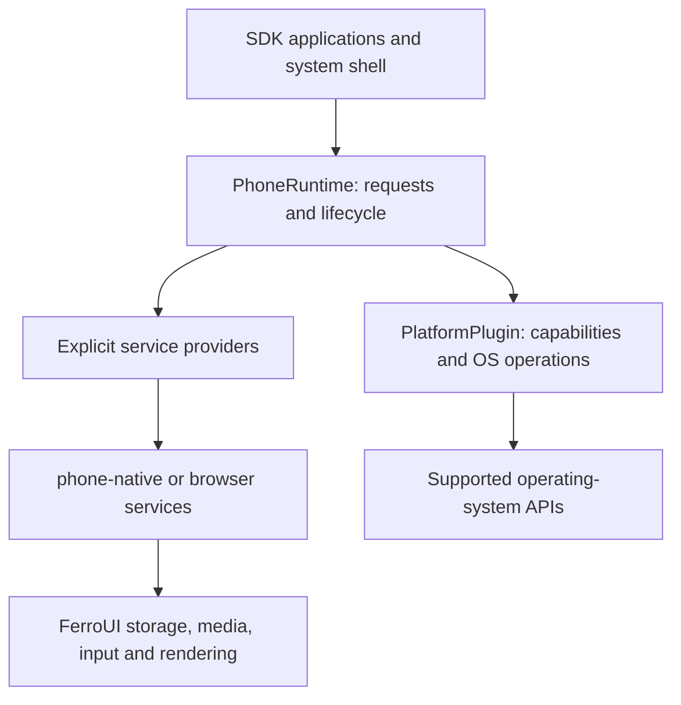

# Portable host and shell architecture

The phone is a FerroUI control tree with shared Rust applications, state and SDK. Its operating-system boundary is composed explicitly. Android, iOS, browser, Windows, macOS and Linux use the same application registrations and navigation model; each host provides its actual capabilities and owns its platform lifetime.

## Package boundaries

| Package | Responsibility |
| --- | --- |
| `phone-host` | Portable requests, environment and platform contracts; explicit service registry; URI/catalog validation; native I/O/network primitives and OS media-session contracts. No UI or app dependencies. |
| `phone-runtime` | UI-thread request broker, capability checks, bounded pending tasks, cancellation, environment merging, lifecycle and validated app activation. Depends on state and the system, not application implementations. |
| `phone-native` | Reusable native phone composition, sandbox persistence and recovery, FerroUI file/clipboard/URI adapters, shared media/camera and import/export workers. |
| `phone-platform-desktop` | Windows/macOS/Linux installed-app catalogs, native activation, system settings and observed session role. |
| `phone-desktop` | Desktop lifetime, window, renderer selection and command-line composition. |
| `phone-android` | FerroUI Android activity host, JNI bridge, sandbox path, Android role/services/media adapter and APK packaging. |
| `phone-ios` | FerroUI UIKit host, application delegate, ARC services bridge, Apple media-session integration and bundle packaging. |
| `phone-browser` | FerroUI WebAssembly lifetime, browser platform bridge and existing web services/PWA implementation. |
| `phone-sdk`, `phone-system`, `phone-ui`, app crates | Trusted app registration/services, shell, default composition and individual applications. |



FerroUI remains responsible for controls, layout, styling, input, dispatch, platform windows/views, graphics, texture interop, native pickers, clipboard, URI activation and media/camera providers. The host code adds phone-specific composition and OS operations that are not exposed by the pinned framework. Shared app screens remain Rust/FerroUI. Android additionally supplies a small native incoming/ongoing call surface because Telecom must be able to present calls without a mounted Rust view.

## Hosting modes and actual authority

`HostMode` expresses the requested presentation. `HostRole` records observed authority: `Unsupported`, `Available`, `Requested` or `Active`. These are separate values. Creating a fullscreen window does not grant a home or shell role.

| Platform | App / embedded surface | Launcher | Shell session |
| --- | --- | --- | --- |
| Android | Native FerroUI activity; application-owned files and normal OS permission flow | Separate HOME APK flavor; explicit `RoleManager.ROLE_HOME` request, then observed role ownership | No replacement of Android System UI, system services or kernel |
| iOS | Native UIKit/Metal application and reusable embedded composition | Not advertised; no installed-app catalog or Home Screen replacement in this adapter | Not advertised |
| Browser | FerroUI WebAssembly app/PWA; embedded mode is explicit | No arbitrary installed-app enumeration or OS HOME authority | Not advertised |
| Windows | Native desktop application or embedded control | Fullscreen native-app launcher using the AppsFolder catalog | Opt-in Shell Launcher configuration on supported editions; adapter verifies a configured shell-host process chain |
| Linux | Native X11 or Wayland application or embedded control | Fullscreen launcher using GIO's installed-app catalog | Opt-in labwc login session; labwc provides window management/compositing, phone provides home/launcher |
| macOS | Native desktop application or embedded control | Fullscreen application launcher using Launch Services / NSWorkspace | Replacement system shell is not advertised |

`PlatformState::validate` rejects impossible combinations, duplicate capabilities and unconfigured shell mode. Android/iOS/browser builds do not inherit desktop shell authority. Desktop HOME-role requests are not substituted for an Android role chooser.

The device catalog is transient and bounded to 4,096 unique entries. Public IDs are opaque identities from the observed OS catalog, never executable command lines. The desktop provider retains native targets privately and revalidates them when launching. Android considers enabled/exported launcher activities visible to the current profile, with manifest-scoped queries rather than broad package visibility.

The shared All apps drawer now incorporates this native catalog with search, alphabet jumps, pins, eligible shortcuts, app information and OS-confirmed uninstall. `AppRegistry::bind` keeps builtin and extension registrations separate, and typed launch-path handlers admit builtin content pins before navigating or changing persistent data.

**Device apps** (`org.ferroui.device`) is an independent SDK app. It presents a virtualized native-app list, search, open, refresh and hold-to-pin. Pins preserve a bounded encoded identity and refresh/revalidate the catalog before launching. The device page reports platform/mode/roles and exposes supported settings, HOME selection, haptics and notification-consent actions. Browser/iOS show the supported integrations without claiming a native app catalog.

## Replaceable services and application composition

`ServiceRegistry` gives one provider ownership of each request family. Duplicate registration fails; replacement is explicit. A denied operation is returned as an error instead of falling through to another provider. Families include networking, files, navigation, clipboard, media, camera, notifications, location, sharing, environment and updates. Platform requests are owned by the separate `PlatformPlugin` contract.

`NativeHost::new` uses the default apps/services. `NativeHost::with_services` customizes service families. `NativeHost::compose` also adds independently compiled SDK applications. A host that replaces the entire default app set can compose `phone_system::create_view` with its own `AppRegistry` and attach `PhoneRuntime` directly.

The following embedding function is complete at the composition boundary. Its owner configures the FerroUI application/fonts/theme first, supplies a real platform plugin and clipboard implementation, and retains the returned host for the lifetime of the mounted control:

```rust
use ferroui_base::Ref;
use ferroui_controls::{ContentControl, Control};
use phone_host::{platform::{HostService, PlatformPlugin}, HostRequest};
use phone_native::{AppRegistration, NativeHost};
use std::{path::PathBuf, rc::Rc};

pub fn mount_phone(
    parent: &Ref<ContentControl>,
    data_file: PathBuf,
    platform: Rc<dyn PlatformPlugin>,
    apps: Vec<AppRegistration>,
    copy_text: Rc<dyn Fn(String) -> Result<(), String>>,
) -> Result<Rc<NativeHost>, String> {
    let host = NativeHost::compose(data_file, platform, apps, move |services| {
        services.replace(
            "company.clipboard",
            HostService::Clipboard,
            Rc::new(move |request| match request {
                HostRequest::CopyText { text } => copy_text(text),
                _ => Err("Unsupported clipboard request.".into()),
            }),
        )
    })?;
    parent.set_content(Some(Control::boxed(&host.view())));
    Ok(host)
}
```

Forward `HostLifecycle::{Resumed,Suspended,Closing}` from the owner. Call `Closing` before removing the view and releasing the host. The pinned shell owns one mounted phone per UI thread; `NativeHost` enforces that constraint instead of allowing global session/media hooks to collide. Application extensions and provider implementations are trusted linked Rust code. This registry is not a process sandbox, a stable binary ABI, or a loader for XAP/APPX packages.

Native mobile entry points mount the measured phone control inside a separate `UserControl` with padding enabled through `TopLevel::set_auto_safe_area_padding`. The runtime observes the inner control's already-inset bounds, and `PhoneScreen` uses that viewport. Applying the padding to the measured control itself would leave the view model reporting its outer size while the child receives a smaller slot, allowing the phone surface to overlap system bars. Embedding owners should preserve this separation when they own the safe-area container.

## Request and lifetime rules

Platform request dispatch begins synchronously inside the input handler so browser share/permission operations retain user activation. The broker validates the request and current platform state, admits at most eight concurrent operations and gives each a monotonically increasing identity. Refresh and catalog requests use last-response-wins channels. Completion is admitted only into the original live runtime and phone-document epoch.

`DeviceRequest`/`DeviceResponse` add bounded hardware, permissions, roles, contacts, calls, messaging, notifications, maps and shortcut operations. Responses must match the original kind and thread/message/app/client identity, and private data must still be permitted by the newest snapshot. `DeviceStore` is transient and is cleared on document replacement or corresponding access revocation. Picker cancellation, native composition, send acceptance and delivery remain separate typed outcomes. [Device integration](device-integration.md#contract-and-ownership) specifies the complete admission and ownership rules.

The runtime owns foreground initialization of device observations. It first obtains a usable snapshot and then starts the message-thread and native notification reads required by Start and Action Center, without requiring navigation to another app. Read ownership follows foreground lifetime, document identity and current authority; equivalent ordinary requests coalesce and transient initialization failures back off. Permission/role changes invalidate the affected reads before private state changes, including full-to-limited contact access. This observation mechanism uses the existing typed provider contract and does not create a background service or request consent on the user's behalf. See [initialization and collection limits](device-integration.md#launcher-observation-initialization).

Closing first flushes app state and cancels SDK tasks, then closes the platform gate and provider. Waiting futures wake and release their provider tasks. Native and JavaScript bridges use bounded request registries; callbacks do not retain Rust UI pointers. A late native response cannot complete a reused request identity. Suspension stops the camera and foreground clock/alarm processing. Foreground alarm suspension preserves the alert/snooze state, stops audio/tactile output and invalidates its presentation latch; a visible tick revalidates the alert before resuming it. Native haptic-capable hosts use bounded foreground alarm pulses that respect the phone vibration setting. Android's explicitly started media playback service can retain ongoing user-started audio; iOS pauses foreground playback because this bundle does not declare background audio. Neither platform resumes media merely because the application becomes visible again.

Native picker/import/export operations carry a runtime/document lease and a captured storage root. Worker jobs receive the correct `AssetStore` explicitly, rather than reading UI-thread-local storage configuration on another thread. Operations recheck scope after asynchronous work and before admitting files or replacing the document. Stale staged imports are cleaned up. A lease does not claim that an OS file picker has a cancellation API; abandoned results are discarded.

Media source generations, document epochs and finite bounded positions also protect OS media commands. The decoder remains FerroUI's platform provider. Windows SMTC, Linux MPRIS, macOS/iOS MediaPlayer and Android MediaSession publish metadata/position and enqueue transport commands. Android audio focus remains with the framework decoder. Background alarms, process resurrection and closed-app reminder scheduling are not implemented by the media service.

## Native mobile services

Android uses public intents and permission APIs for application/network/notification/default-app settings, text sharing, haptics, notification consent and foreground banners, one-shot foreground location, battery/network observations and user-selected HOME. Its ordinary App APK has no HOME category. The Launcher APK has the required HOME filter and a separate application identity. Both use the framework activity/rendering/input lifetime and singleTask activation handling.

The Android provider also implements the default dialer/InCallService and SMS/MMS role components, real contacts and call history, durable message jobs/provider persistence, notification-listener actions and eligible HOME shortcuts. Shared quick actions and Settings use 25 typed hardware controls and 43 destination contracts with explicit writable/panel/permission/read-only/unavailable state. Native Back is subscribed through FerroUI's routed Back event; HOME opens Start. Role and runtime permission requests remain independently controlled by Android.

Android external media handoff uses a private FileProvider restricted to the app's assets subtree. Canonical file identity, regular-file ownership, bounded content and temporary read-only URI leases are checked independently of the Rust asset validation. The service is private and declares only media playback foreground-service authority; no boot autoplay or background-start bypass is added.

iOS uses public UIKit settings URLs, UIActivityViewController, foreground CoreLocation, UserNotifications, haptic feedback and battery/power observations. The app supplies camera/location usage descriptions. File share controllers and their completion objects remain retained until dismissal and have an iPad presentation anchor. Sandbox-owned regular assets are validated again at the native boundary. AVAudioSession playback activation and interruption/headphone-disconnection handling accompany MediaPlayer transport controls.

iOS now includes full/limited Contacts access, native message composition with correlated document-picked attachments, public brightness/torch/volume/route controls and MapKit integration. The opt-in `ios26-telephony` provider adds entitled cellular dialing/history, SMS/MMS sends and incoming SMS/MMS/RCS text/files with private journaling. Real signed entitlements, role, OS, device and service availability gate these operations. The standard build and simulator do not gain carrier authority by enabling a feature. No iOS HOME replacement, notification-listener catalog, outbound RCS chat or carrier in-call controls are advertised.

The embedded Maps viewport uses the same network service family, with fixed validated tile requests, visible-only scheduling, bounded HTTP-aware caching and scoped decoded-image leases. Tile templates and publishers similarly use shared domain/state/SDK ownership rather than a native per-platform tile implementation. See [device integration](device-integration.md) for provider cache policy, notification preferences and physical qualification boundaries.

Platform operations report observed availability, denial, cancellation or acceptance. Acceptance by an OS API does not prove recipient delivery, permission approval, target-app startup or successful physical playback.

## Startup and deployment

```sh
# Existing desktop session
cargo run --locked -p phone-desktop -- --mode app
cargo run --locked -p phone-desktop -- --mode launcher
# Linux native backend selection
cargo run --locked -p phone-desktop -- --mode launcher --backend wayland
cargo run --locked -p phone-desktop -- --mode app --backend x11
# Validated SDK activation (also supported by mobile platform entry points)
cargo run --locked -p phone-desktop -- --activate 'ferroui-phone://app/org.ferroui.device'
# Android application and HOME flavors
bash scripts/build-android.sh
bash scripts/build-android.sh --launcher --no-cargo
# macOS/Xcode: iOS Simulator bundle
bash scripts/build-ios.sh --target aarch64-apple-ios-sim
```

Activation accepts only `ferroui-phone://home` or `ferroui-phone://app/APP_ID?path=ENCODED_PATH`. Credentials, fragments, duplicate/unknown query parameters, control characters and oversized identities/paths are rejected. A startup link waits for the root SDK session to mount; disabled or unregistered targets are refused.

Typed payload delivery and its base navigation share a FerroUI reactive batch. The normal destination lifecycle runs before activation; a synchronous app-owned redirect, such as Settings opening `device services`, remains the final destination. Launch acceptance checks the registered owner of that destination and revalidates the original model, mounted session, phone-document epoch and app availability. An app callback that restores the document, closes or replaces the shell, or redirects to another app cannot make the original launch succeed. Overlay callbacks execute without retaining a route-state borrow.

See [Android packaging](../crates/phone-android/README.md), [iOS packaging](../crates/phone-ios/README.md), [Linux session staging](../crates/phone-desktop/platform/linux/README.md), [Windows shell deployment](../crates/phone-desktop/platform/windows/README.md) and [desktop prerequisites](../crates/phone-desktop/platform/README.md). Session generators produce reviewable install/configuration artifacts. Creating them does not change the current machine's default launcher, login session, policies or shell. Mobile debug artifacts are development packages; device/distribution signing is separate.

The `[verify-mobile]` commit marker enables the ARM64 Android package and iOS Simulator gates; `[verify-android]` and `[verify-ios]` select one. `[verify-android-ui]` selects the independent Android 36 x86_64 emulator gate. Besides mounted safe-area geometry and real route/Back/HOME input, its isolated fixture temporarily selects HOME and verifies both actual role ownership and the independent active-launcher snapshot, HOME reentry and Back at Start, then restores the original holder. It also temporarily selects and restores dialer/SMS roles, receives a modem SMS through the real provider path and answers an emulator call through native UI. All role changes are confined to the newly created private emulator; the gate never dials a real recipient. The iOS gate builds standard/optional providers, type-checks physical-iPhone Swift, and verifies native routes, real Contacts CRUD and read-only simulator brightness observation/refusal while reporting simulator carrier APIs unavailable. Physical brightness writes remain a device qualification step. Add `[mobile-only]` for a mobile verification change that does not need a browser or desktop rebuild. Skipped mobile runs have separate concurrency identities, so an Android-only retry does not cancel an active iOS run. `[verify-native]` adds Windows/macOS/Linux build/link and protocol checks; `[verify-ui]` enables rendered browser interaction tests with controlled map tile responses. Verification records distinguish source implementation, compile/package checks, simulator interaction and physical-device qualification. No build result by itself establishes permissions, hardware, compositor/device policy or complete Windows Phone fidelity.

## Primary platform references

- [Android roles and HOME consent](https://developer.android.com/reference/android/app/role/RoleManager)
- [Android foreground-service types](https://developer.android.com/develop/background-work/services/fgs/service-types)
- [Android FileProvider](https://developer.android.com/reference/androidx/core/content/FileProvider)
- [Apple default-app capabilities](https://developer.apple.com/documentation/updates/defaultapps)
- [Apple activity controllers](https://developer.apple.com/documentation/uikit/uiactivityviewcontroller)
- [Apple audio interruptions](https://developer.apple.com/documentation/avfaudio/avaudiosession/interruptionnotification)
- [Windows Shell Launcher requirements](https://learn.microsoft.com/windows/configuration/shell-launcher/)
- [GIO desktop applications](https://docs.gtk.org/gio/class.DesktopAppInfo.html)
- [Browser related-app visibility](https://developer.chrome.com/docs/capabilities/get-installed-related-apps)
